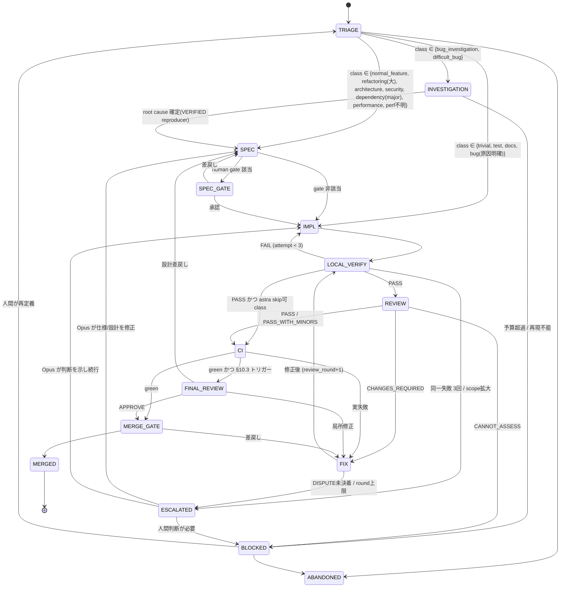

# AI開発ワークフロー（Opus / Sonnet / Astra）

Version: 1.0（Status: **Proposed** — 人間が承認するまで確定仕様ではない）

本書は運用の正本。各モデルが毎セッション読む要約は `/CLAUDE.md`（Claude Code）と `/AGENTS.md`（Codex / Astra）にある。
プロンプト本体は `docs/ai-workflow/prompts/`、テンプレートは `docs/ai-workflow/templates/`、補助スクリプトは `scripts/ai/` に置く。

配置ファイル:

```
CLAUDE.md                              # Claude Code 全セッション共通ルール（要約）
AGENTS.md                              # Codex / Astra 用ルール（要約）
.claude/settings.json                  # 既定モデル=Sonnet、危険操作と Agent tool の deny、hook 登録
.claude/hooks/guard_decisions.py       # AI による ADR の Accepted 化をブロック
.claude/commands/ai-spec.md            # /ai-spec <task_id>        (Opus)
.claude/commands/ai-impl.md            # /ai-impl <task_id>        (Sonnet)
.claude/commands/ai-escalation.md      # /ai-escalation <task_id> <stage> (Opus)
docs/ai-workflow/WORKFLOW.md           # 本書
docs/ai-workflow/prompts/              # opus-architect / sonnet-implementer / astra-review / parallel-investigation
docs/ai-workflow/templates/            # task.yaml / log.md / hypotheses.md
docs/decisions/                        # ADR（0000-template.md）
scripts/ai/new-task.sh                 # ブランチ + worktree + tasks/<id>/ 作成
scripts/ai/run-checks.sh               # 証跡ログ生成（§12.3）
scripts/ai/review-bundle.sh            # Astra 用の独立レビュー入力生成（§8.1）
scripts/ai/checks.txt                  # 証跡に使うチェックコマンド（要設定）
tasks/<task_id>/                       # タスクごとの状態（§1.3）
```

最適化の優先順位（衝突時は上が勝つ）:
1. correctness 2. reproducibility 3. auditability 4. silent failure防止 5. agentミスの封じ込め 6. 開発速度 7. token/APIコスト

---

## 1. 推奨workflow全体像

### 1.1 通常経路（大半のタスクはこれで終わる）

```
REQUEST ─► TRIAGE ─► [SPEC] ─► IMPL ─► LOCAL_VERIFY ─► REVIEW ─► FIX ─► CI ─► [FINAL_REVIEW] ─► MERGE_GATE ─► MERGED
  人間       人間     Opus     Sonnet    Sonnet         Astra    Sonnet  CI      Opus            人間
```

- `[SPEC]` は class が trivial / test / docs / 単純バグの場合は省略（依頼文 + task.yaml の AC が仕様になる）。
- `[FINAL_REVIEW]` は §10.3 のトリガーに該当した場合のみ。
- REVIEW（Astra）は「振る舞いが変わる変更」すべてに必須。省略できるのは §4 で `astra: skip可` の class のみ。

### 1.2 オーケストレーターは「LLMではない」

ステージ遷移を決めるのは **人間**（Phase 1〜3）または **決定的なスクリプト**（Phase 4以降、任意）。
LLM をオーケストレーターにしない。理由: LLMオーケストレーターは「もう少し調べる」「別モデルに聞く」を自己判断で連鎖させ、§11 のループ制限を自分で緩める動機を持つため。

モデルは自分の担当ステージを終えたら **ステージ完了報告を出して停止する**。次のモデルを自分で呼ばない。

### 1.3 状態の置き場所

すべての状態は Git 上のファイルにある。会話履歴は状態ではない。

```
tasks/<task_id>/
  task.yaml          # 標準タスク（§5）。ステージ・owner・scope・AC・承認・カウンタ
  spec.md            # Opus の仕様/設計（SPECを経たタスクのみ）
  log.md             # 実装者ログ（判断理由・試したこと）。Astra初回監査には渡さない
  hypotheses.md      # 調査タスクの仮説台帳（§9, §11）
  escalations.md     # エスカレーション記録（§10）
  evidence/*.log     # scripts/ai/run-checks.sh が生成する実行証跡（§12）
  reviews/           # astra-r1.md, responses-r1.md, opus-final.md など
docs/decisions/      # ADR。Accepted にできるのは人間のみ（§14）
```

### 1.4 各ステージ定義

| Stage | Owner | Input | Output | Allowed | Forbidden | Exit criteria | Escalation |
|---|---|---|---|---|---|---|---|
| **REQUEST** | 人間 | 要望 | issue / 依頼文 | — | — | 依頼文が存在 | — |
| **TRIAGE** | 人間（Sonnetが下書き可） | 依頼文 | `task.yaml`（class, risk, scope案, gates） | task.yaml作成、routing（§4） | コード変更 | class と owner が決まり、並行タスクと allowed_scope が重複しない | class判断不能 → §4.2 |
| **SPEC** | Opus | task.yaml, 依頼文, 関連コード（読取） | `spec.md`, 確定版 AC, allowed/forbidden scope, タスク分割, ADR(Proposed) | 読取、spec.md/task.yaml/ADR(Proposed)の作成 | 実装コード変更、ADRを Accepted にする、依頼にない機能追加 | 全ACが検証方法付きで書かれ、open_questions が空 or 人間の回答待ちとして明示 | 要件矛盾・gate該当 → MERGE不可のまま人間へ（SPEC_GATE） |
| **SPEC_GATE** | 人間 | spec.md, ADR | 承認記録（task.yaml `approvals.granted`） | 承認・差戻し | — | 必要な gate がすべて granted | — |
| **IMPL** | Sonnet | task.yaml, spec.md | commits（test先行が原則）, log.md | allowed_scope 内の編集、テスト追加、ローカル実行 | scope外編集、依存追加（未承認）、AC変更、テスト削除/skip化、subagent起動 | 全ACに対応するコード+テストがcommit済み | §10.1 |
| **LOCAL_VERIFY** | Sonnet | HEAD | `evidence/*.log`, AC別ステータス | `scripts/ai/run-checks.sh` 実行 | 証跡なしの「通った」報告 | 全checkが PASS の証跡が HEAD のコード状態に一致 | 同一失敗3回 → §11 |
| **REVIEW** | Astra | review bundle（§8: spec, AC, diff, ソース, 証跡）**のみ** | `reviews/astra-rN.md` | 読取、bundle内でのテスト実行/実験（別worktree） | 実装worktreeの編集、log.md参照、修正コードのcommit | 全観点（§8）を判定し verdict を出した | 情報不足 → `CANNOT_ASSESS` で停止 |
| **FIX** | Sonnet | astra-rN.md | fix commits, `reviews/responses-rN.md` | 指摘ごとの修正、反証付き DISPUTE | 指摘範囲外の改善、指摘を無視して黙って close | BLOCKER/MAJOR が全て FIXED（証跡付き）or DISPUTED（証拠付き） | DISPUTE未決着 → Opus裁定（§10.2） |
| **CI** | CI | push | CI結果 | 1回のみ再実行（基盤障害が明らかな場合） | 失敗テストのskip、空commitでの再実行 | 全required checks green | 2回目の失敗 → 実失敗として FIX へ |
| **FINAL_REVIEW** | Opus | spec.md, 全diff, astra-rN, responses, 証跡 | `reviews/opus-final.md`（APPROVE / CHANGES_REQUIRED） | 読取、設計観点の指摘 | 自分でコード修正、新規要件追加 | verdict 出力 | 設計見直し要 → SPECへ差戻し |
| **MERGE_GATE** | 人間 | PR, task.yaml, 証跡, レビュー | merge or 差戻し | merge | — | §12.4 の merge条件を全て満たす | — |

---

## 2. 状態遷移図



レビュー2周目（FIX → LOCAL_VERIFY → REVIEW）は `limits.max_review_rounds`（既定2）まで。超えたら ESCALATED。

---

## 3. モデル別責務表

| 責務 | Opus 5.5 | Sonnet 5.5 | GPT-6 Astra | 人間 |
|---|---|---|---|---|
| 要件整理・仕様化 | **主** | 下書きのみ（trivial等） | — | 承認 |
| アーキテクチャ設計 / ADR | **主**（Proposedまで） | — | 監査対象として指摘可 | **Accepted判断** |
| タスク分割 | **主** | — | — | 承認 |
| 通常実装・リファクタ | 原則しない | **主** | しない | — |
| テスト作成 | AC→テスト観点の指定 | **主** | 不足の指摘 | — |
| lint/type修正 | — | **主** | — | — |
| 独立コードレビュー | 大規模変更のみ設計観点 | — | **主** | 最終判断 |
| 難バグ root cause | **並行・独立** | 修正実装のみ | **並行・独立** | 決着基準の確認 |
| 外部仕様/API/ライブラリ整合 | 設計時の前提確認 | — | **主**（レビュー時） | — |
| ステージ遷移 | — | — | — | **主**（orchestrator） |
| 仕様変更 | 提案 | 不可 | 指摘のみ | **決定** |

---

## 4. Task Routing Table

### 4.1 クラス別ルーティング

`astra` 列: `必須` = REVIEW必須 / `skip可` = 振る舞い不変を Sonnet が証跡で示せる場合のみ省略可（省略理由を task.yaml に記録）。

| class | 典型例 | SPEC | 実装 | astra | Opus最終 | 人間gate |
|---|---|---|---|---|---|---|
| `trivial` | typo、ログ文言、定数の明白な誤り | 不要 | Sonnet | skip可（ロジック変更があれば必須） | 不要 | 不要 |
| `normal_feature` | 既存設計内の機能追加 | **Opus** | Sonnet | 必須 | トリガー時 | public API変更時 |
| `refactoring` | 振る舞い不変の構造改善 | 小: 不要 / 複数モジュール: Opus | Sonnet | 必須（regression観点） | 複数subsystem時 | 不要 |
| `architecture_change` | モジュール境界・データフロー変更 | **Opus** + ADR | Sonnet（分割タスク） | 必須 | **必須** | **G1** |
| `bug_investigation` | 原因不明だが再現可能 | 不要 | Sonnet が調査→reproducer→修正 | 必須 | 不要 | 不要 |
| `difficult_bug` | 再現困難、複数subsystem、非決定的 | Opus/Astra **並行調査**（§9） | Sonnet | 必須 | 必須 | 修正が gate 該当時 |
| `performance` | 遅延・メモリ | 計測基準を Opus が定義（改善目標・測定方法） | Sonnet | 必須（計測の妥当性も） | 設計変更を伴う時 | 不要 |
| `security` | 認証、入力検証、ファイル読込の信頼境界 | **Opus** | Sonnet | 必須（security観点重点） | **必須** | **G4** 該当時 |
| `dependency_update` | patch/minor更新 | 不要 | Sonnet | 必須（changelog/破壊的変更確認） | 不要 | major・新規追加は **G6** |
| `test_creation` | テストのみ追加 | 不要 | Sonnet | skip可（テストがAC/仕様を正しく表すかを見たい場合は必須） | 不要 | 不要 |
| `documentation` | README、docstring | 不要 | Sonnet | skip可 | 不要 | 仕様文書の変更は **G8** |
| `external_spec_research` | FBX仕様、Blender API、外部ライブラリ挙動 | — | — | **Astra 主**（調査レポート、コード変更なし） | 設計判断に使う場合 Opus が採否 | 不要 |

### 4.2 曖昧な場合のrouting規則（上から順に適用）

1. **2つのclassで迷ったら、リスクが高い方を選ぶ。** 後から下げるのは安く、上げ損ねたコストは高い。
2. **ACを「1〜3個の、テストで検証できる文」で書けないなら SPEC（Opus）へ。** 書けるなら Sonnet 直行でよい。
3. **原因が分かっていない不具合は「修正」タスクにしない。** `bug_investigation` として reproducer 作成を最初の exit criteria にする。
4. **§14 の human gate に触れうるなら、その時点で gate を task.yaml に宣言する。** 実装後に気付くのは手戻り。
5. **変更予定ファイルが既存 open タスクの allowed_scope と重なるなら、着手しない。** 先行タスク完了まで待つか、人間がスコープを再分割。
6. **TRIAGE に 15 分以上かかる場合は「仕様が未成熟」と判断し SPEC へ。**

---

## 5. Standard Task Schema

正本: `docs/ai-workflow/templates/task.yaml`。`scripts/ai/new-task.sh` がこれを `tasks/<id>/task.yaml` に展開する。

依頼例のスキーマに対する主な追加と理由:

| 追加フィールド | 理由 |
|---|---|
| `class`, `risk` | routing（§4）と gate 判定を再現可能にする |
| `acceptance_criteria[].verification` / `.status` / `.evidence` | 「何で検証したか」をACごとに追跡。完了報告の虚偽を防ぐ（§12） |
| `non_goals` | scope拡大の判断基準。「やらないこと」の明示 |
| `allowed_scope.change_types` | パス単位だけでは「同じファイル内の無関係な改善」を止められない |
| `approvals.required/granted` | Accepted Decision は人間だけ（§14） |
| `limits` / `counters` | ループ防止の上限を機械的に確認可能にする（§11） |
| `stage_history` | 誰がいつどのステージを担当したかの監査証跡 |
| `git.base_commit` | レビューdiffと再現の基準点 |
| `follow_ups` | 範囲外の気付きを「やらずに記録する」場所（§11） |

**記述ルール**: task.yaml に実装判断の理由（「なぜこう書いたか」）は書かない。それは log.md に書く。task.yaml は Astra に渡るため。

---

## 6. Opus用 system/workflow prompt

正本: `docs/ai-workflow/prompts/opus-architect.md`

起動例（Claude Code、別セッション）:

```bash
cd ../wt/<task_id>
claude --model claude-opus-5-5 \
  --append-system-prompt "$(cat docs/ai-workflow/prompts/opus-architect.md)"
# または Claude Code 内で: /ai-spec <task_id>
```

要点: 実装しない／ADRは Proposed まで／AC は検証方法付き／出力したら停止。

---

## 7. Sonnet用 implementation prompt

正本: `docs/ai-workflow/prompts/sonnet-implementer.md`（Implementation Contract §D を含む）

起動例:

```bash
cd ../wt/<task_id>
claude --model claude-sonnet-5-5 \
  --append-system-prompt "$(cat docs/ai-workflow/prompts/sonnet-implementer.md)"
# または /ai-impl <task_id>
```

`.claude/settings.json` の既定モデルを Sonnet にしてあるため、特に指定がなければ Sonnet が起動する。

---

## 8. Astra用 independent review prompt

正本: `docs/ai-workflow/prompts/astra-review.md`

### 8.1 独立性を物理的に担保する

プロンプトで「log.md を読むな」と書くだけでは不十分。**読めない状態で渡す**。

```bash
scripts/ai/review-bundle.sh <task_id> <round> [base_ref]
# → ../_review/<task_id>-r<round>/
#      src/      git archive HEAD（.git なし = commit message/履歴なし、tasks/ 削除済み）
#      bundle/   task.yaml, spec.md, diff.patch, diffstat.txt, evidence/(HEADのコード状態に一致するもののみ), MANIFEST.md
#      bundle/prior/ (round>=2 のみ) 前回の astra-r*.md と responses-r*.md
```

起動例（Codex CLI。モデルIDは導入時に要確認）:

```bash
cd ../_review/<task_id>-r1
codex exec --sandbox read-only -m "$ASTRA_MODEL" \
  "$(cat <repo>/docs/ai-workflow/prompts/astra-review.md)" \
  > <repo>/tasks/<task_id>/reviews/astra-r1.md
```

### 8.2 残存リスク（既知）

- ソースコード中のコメントは実装者の意図を含みうる。完全な遮断はできない。Sonnet契約で「理由はコードコメントでなく log.md へ」としているのはこのため。
- round 2 以降は `responses-rN.md`（Sonnetの指摘への回答）を渡す。これは意図的な独立性の緩和であり、初回監査では渡さない。

---

## 9. Difficult bug 用 Opus/Astra 並行調査

正本: `docs/ai-workflow/prompts/parallel-investigation.md`

手順:

1. 人間（または Sonnet が下書きし人間が確認）が **problem statement** を `tasks/<id>/problem.md` に書く。内容は観測事実のみ（症状、再現手順、ログ、環境、発生頻度、直近の変更）。**推測・仮説を含めない**（片方の仮説で両者を汚染しないため）。
2. 同一の problem.md と同一のソーススナップショット（`review-bundle.sh` と同じ export）を Opus と Astra に**別々に**渡す。互いの出力は見せない。
3. 各自 `tasks/<id>/investigation/opus.md` / `astra.md` を出力（形式はプロンプト参照: root cause候補・根拠・再現条件・falsification方法・最小reproducer・修正方針・confidence）。
4. 人間が両方を `hypotheses.md` に統合（H-1, H-2, …）。**多数決はしない。**
5. Sonnet が各仮説の falsification test / reproducer を実装・実行する（実験は `exp/<task_id>/<H-id>` ブランチ）。結果を証跡付きで hypotheses.md に `CONFIRMED / REFUTED / INCONCLUSIVE` と記録。
6. CONFIRMED が1つに絞れたら、reproducer を回帰テストとして SPEC → IMPL（通常経路）。
7. 全仮説 REFUTED / INCONCLUSIVE → 新規証拠（計測・ログ追加）を集める計画を Opus が1回だけ立てる。それでも決着しなければ BLOCKED（人間判断）。

---

## 10. Escalation rules

### 10.1 Sonnet → Opus（IMPL / FIX 中）

以下のいずれかに該当したら **作業を止め**、`escalations.md` に記録し、stage を `ESCALATED` にして停止。

| # | 条件 | 判定の目安 |
|---|---|---|
| E1 | 要件とコード構造が矛盾 | AC を満たすには spec.md の設計前提を破る必要がある |
| E2 | architecture変更が必要 | モジュール境界・データフロー・責務分担の変更 |
| E3 | public API変更が必要 | 公開関数/クラス/オペレーター/プロパティのシグネチャ・意味の変更 |
| E4 | 永続化形式・protocol・schema変更 | ファイルフォーマット、保存データ、設定形式 |
| E5 | dependency追加/大幅変更 | `dependencies.packages_allowed_to_add` にないもの |
| E6 | security-critical な判断 | 信頼境界、外部入力のパース、権限、秘密情報 |
| E7 | 同一失敗に対する修正 3回失敗 | §11 L1 |
| E8 | 変更範囲が当初想定を大幅超過 | allowed_scope 外のファイル変更が必要、または diff が見積りの2倍超 |
| E9 | AC 自体が不十分/矛盾/検証不能 | AC を満たしても依頼目的を達成しないと判明 |

**エスカレーションしてはいけないもの**: 変数名、関数分割、テストケースの書き方、ローカルなアルゴリズム選択（計算量が同オーダー）など allowed_scope 内で完結する実装詳細。Sonnet が決めて log.md に残す。

エスカレーション記録の形式:

```markdown
## ESC-<n> (<stage>, <date>, by sonnet)
condition: E3
summary: <1-2文>
evidence: <ファイル:行, evidence/xxx.log, コマンド出力>
options_considered: <あれば。推奨はしてもよいが決定はしない>
blocked_work: <止まっている AC>
```

### 10.2 Sonnet ⇄ Astra の意見不一致

1. Sonnet は指摘に `DISPUTED` を付ける場合、**反証の証拠**（テスト・再現手順・仕様の該当箇所）を responses に必須で記載。言い分だけの DISPUTE は無効（FIX扱いに戻す）。
2. Astra の round 2 で DISPUTE が覆らなければ Opus 裁定。Opus は「どちらが正しいか」を意見で決めず、**決着させる test / measurement を指定**し、Sonnet がそれを実装・実行して結果で決める。

### 10.3 Opus FINAL_REVIEW のトリガー

いずれか1つで発動:

- class が `architecture_change` / `security` / `difficult_bug`
- 2つ以上の subsystem（トップレベルパッケージ）にまたがる
- diff が 400行超（tests除く）
- public API / 永続化形式の変更を含む
- §10.2 の裁定が発生した
- Astra が `confidence: high` の BLOCKER を出し、Sonnet が DISPUTE した

### 10.4 → 人間

- §14 の gate に該当
- Opus の裁定でも決着しない
- 予算（§11）超過で BLOCKED
- AI が仕様変更を必要と判断した（AI は仕様を変えられない）

---

## 11. Loop prevention rules

上限値は task.yaml `limits` で上書き可能だが、上げるには人間の記録が必要。

| ID | ルール | 上限/基準 | 超過時 |
|---|---|---|---|
| L1 | 同一失敗への修正試行 | 3回（同一 = 同じテストID + 同じエラーシグネチャ） | ESCALATED (E7) |
| L2 | タスク全体の check 実行 | 12回（`run-checks.sh` が evidence 件数で判定し exit 4 で拒否） | 停止して人間に状況報告 |
| L3 | Astra レビュー round | 2回 | ESCALATED |
| L4 | 調査の仮説数 | 1調査者あたり 5個 | 報告して停止 |
| L5 | 同一仮説の再検証 | REFUTED 済み仮説は**新規証拠の引用なしに再オープン禁止** | — |
| L6 | 新規証拠なしの再調査 | 禁止。再調査依頼には「前回以降に得た新しい事実」を必須記載 | — |
| L7 | 同一ソースの再読 | 前回から変更されていないファイルを同一セッションで読み直さない（必要箇所はメモを log.md に） | — |
| L8 | 証跡なし修正 | 修正は「失敗している check の証跡」または「レビュー指摘ID」に紐付くもののみ | 紐付かない変更は revert |
| L9 | scope拡大 | allowed_scope 外の変更は禁止。必要なら E8 | ESCALATED |
| L10 | 「念のため」作業 | AC・指摘・失敗check のどれにも紐付かない追加作業（追加リファクタ、追加テスト範囲拡大、追加調査）は禁止 | revert |
| L11 | 完了後の探索 | exit criteria を満たしたら**直ちに完了報告して停止**。気付きは `follow_ups` に1行で記録するだけ | — |
| L12 | 委譲 | モデルは subagent / 他モデルを起動しない（`.claude/settings.json` で Agent tool を deny） | — |
| L13 | 同一コマンドの無変更再実行 | コード・入力が変わっていないのに同じ check を再実行して結果を待たない（flaky判定は CI で1回だけ） | — |

**「まだ調べられる」は継続理由にならない。** 継続理由として認められるのは「exit criteria の未達項目 X を満たすために Y が必要」という形式のみ。

---

## 12. Evidence / Completion rules

### 12.1 ステータス定義

| Status | 定義 | 必要な証拠 |
|---|---|---|
| `VERIFIED` | 実装済みで、指定された検証が**現在のコード状態**で成功した | evidence ログ（コマンド, commit, exit code, 出力）。ログのcommitと現HEADのコード差分（tasks/除く）がゼロ |
| `PARTIALLY_VERIFIED` | 一部の検証のみ成功 | 成功した部分の証跡 + **未検証部分の明示列挙** |
| `IMPLEMENTED_UNVERIFIED` | コードはあるが検証していない/できない | 未検証の理由 |
| `BLOCKED` | 外部要因で進められない | ブロック要因と、解除に必要なもの |
| `HYPOTHESIS` | 推測。未検証の原因・挙動説明 | 根拠と、検証方法（falsification） |
| `REFUTED` | 仮説が検証で否定された | 否定した証跡 |

### 12.2 禁止表現と置換

| 禁止 | 必須形式 |
|---|---|
| 「テストが通りました」 | 「`tasks/T-x/evidence/20261001T1200-checks.log`（commit abc1234）で pytest 42 passed / 0 failed, exit 0」 |
| 「バグを修正しました」 | 「修正を実装。修正前に失敗していた `tests/test_x.py::test_y`（evidence/…-before.log, exit 1）が修正後に成功（evidence/…-after.log, exit 0）」 |
| 「問題ないはずです」「動くと思います」 | `HYPOTHESIS` または `IMPLEMENTED_UNVERIFIED` と明記 |
| 「すべて完了」 | AC ごとのステータス表 |

### 12.3 証跡の作り方

`scripts/ai/run-checks.sh <task_id>` が `scripts/ai/checks.txt` のコマンドを実行し、`tasks/<id>/evidence/<timestamp>-checks.log` にコマンド・commit・exit code・出力を記録する。

- tasks/ 以外に未commitの変更があると実行を拒否する（証跡と commit の対応を保証するため）。
- `checks.txt` に有効なコマンドがない場合は**失敗**扱い（「チェックが無いので通った」を防ぐ）。
- 個別コマンド（reproducer等）は `run-checks.sh <task_id> -- <command...>`。
- 実行回数が `limits.max_check_runs` に達すると実行を拒否する（exit 4, §11 L2）。
- exit code: 0 全成功 / 1 失敗あり / 2 前提条件違反 / 3 チェック未設定 / 4 ループ上限。

### 12.4 完了報告フォーマット（全モデル共通）

```markdown
## Stage report: <task_id> / <stage> / <model>
head: <commit sha>
result: DONE | ESCALATED | BLOCKED

| AC | status | evidence |
|---|---|---|
| AC-1 | VERIFIED | evidence/20261001T1200-checks.log |
| AC-2 | IMPLEMENTED_UNVERIFIED | Blender 4.2 実機での確認未実施 |

checks: <evidence path> — <PASS/FAIL 要約>
unverified: <列挙。なければ "none">
scope: allowed_scope 外の変更 なし | あり(<理由, ESC-n>)
follow_ups: <範囲外の気付き。実施していない>
```

### 12.5 Merge 条件

- 全 AC が `VERIFIED`（`PARTIALLY_VERIFIED` / `IMPLEMENTED_UNVERIFIED` が残る場合は、人間が残存リスクを承知した記録が task.yaml にあること）
- Astra 最新 round に未解決の BLOCKER / MAJOR がない（または Opus 裁定で決着済み）
- CI green（最新 HEAD）
- `approvals.required` がすべて `granted`
- FINAL_REVIEW トリガー該当時は Opus APPROVE

---

## 13. Git / worktree 運用

### 13.1 単位

**1タスク = 1ブランチ = 1 worktree = 同時に1 owner**

| 用途 | ブランチ | worktree | 書込み権限 |
|---|---|---|---|
| 実装 | `ai/<task_id>` | `../wt/<task_id>` | その時点の owner（IMPL/FIX中は Sonnet、SPEC中は Opus） |
| レビュー | なし（export） | `../_review/<task_id>-rN`（`.git` なし） | Astra（実験は自由。成果は破棄される） |
| 実験/仮説検証 | `exp/<task_id>/<H-id>` | `../wt/exp-<task_id>-<H-id>` | 実験担当。**main へ直接 merge 禁止**。有効な成果は Sonnet が `ai/<task_id>` へ改めて実装 |

`scripts/ai/new-task.sh <task_id> <class> [base]` がブランチ・worktree・タスクディレクトリを作る。

### 13.2 Commit 単位と message

ステージと AC/指摘に紐付けた小さな commit。squash は merge 時のみ。

```
spec(T-20261001-fbx-normals): add spec and AC           # Opus
test(T-20261001-fbx-normals): AC-1 failing test         # Sonnet（テスト先行）
feat(T-20261001-fbx-normals): AC-1 split normals export
fix(T-20261001-fbx-normals): A-r1-03 handle empty mesh  # Astra 指摘ID
evidence(T-20261001-fbx-normals): checks after A-r1-03
```

commit message には「何を」を書き、「なぜそう判断したか」の長文は log.md へ（commit message は git archive では落ちるが、PR等で Astra に流れやすいため）。

### 13.3 規則

- **同一 worktree の同時編集禁止**。ステージの owner 交代時は、前 owner が commit を終えてから交代する。
- force push / `git reset --hard` / `rebase` は、**初回 REVIEW 前の自分のブランチ**でのみ許可（レビュー開始後は diff の基準を動かさない。base の取り込みは merge commit）。
- **diff review の基準**は `git merge-base <base> HEAD`。bundle 作成時に固定され MANIFEST に記録される。
- **Rollback**: main 上の問題は `git revert <merge commit>`（履歴改変しない）。worktree が壊れた場合は worktree を削除し、最後の良い commit から作り直す（§15）。
- **Conflict**: Sonnet が解決してよいのは allowed_scope 内の機械的衝突（import順、隣接行）のみ。両側がロジックを変更している場合は ESCALATED（どちらの振る舞いを残すかは設計判断）。
- **並行タスク**: allowed_scope.paths が重なるタスクは同時に IMPL に入れない（TRIAGE で確認）。

---

## 14. Human approval gates

AI は以下を**提案**できるが、**決定**できない。承認は task.yaml `approvals.granted` に `by: human:<name>` で記録し、ADR は人間が `status: Accepted` に変更する（`.claude/hooks/guard_decisions.py` が AI による Accepted 化をブロック）。

| Gate | 対象 | 承認タイミング |
|---|---|---|
| G1 | architecture変更 | SPEC_GATE |
| G2 | 外部 API / public API の破壊的変更（アドオンのオペレーター名・プロパティ、出力ファイル互換性を含む） | SPEC_GATE |
| G3 | 永続化形式・database・migration | SPEC_GATE、かつ MERGE_GATE |
| G4 | credential / 認証 / 権限 / 秘密情報の扱い | SPEC_GATE |
| G5 | destructive operation（データ削除、履歴改変、ユーザーファイル上書き挙動） | 実行前 |
| G6 | 依存の新規追加・major更新・削除 | SPEC_GATE（または IMPL中の ESC 経由） |
| G7 | production infrastructure / CI / release 設定の変更 | MERGE_GATE |
| G8 | 仕様（spec.md の AC, docs/decisions, 本ワークフロー）自体の変更 | 変更前 |
| G9 | ループ上限（§11）の引き上げ、Astra review の省略（skip可 class 以外） | 実施前 |

**Accepted Decision の定義**: `docs/decisions/` の ADR で `status: Accepted` かつ `accepted_by: human:<name>` を持つもの。それ以外（AI の提案、会話中の合意、log.md の記述）はすべて Proposed として扱う。

GitHub 側でも以下を設定すること（AI からは設定できない／すべきでない）:
- main への branch protection（required checks、required review 1名以上）
- `CODEOWNERS` で `docs/decisions/`, `docs/ai-workflow/`, `CLAUDE.md`, `AGENTS.md`, `.claude/`, `scripts/ai/` を人間オーナーに

---

## 15. Failure recovery procedure

| 事象 | 検知 | 手順 |
|---|---|---|
| **虚偽/過大な完了報告** | 証跡の欠如、証跡 commit と HEAD のコード差分、CI失敗 | 1) 該当タスクの全 AC を `IMPLEMENTED_UNVERIFIED` に降格 2) `run-checks.sh` で再検証 3) `log.md` に incident 記録（何を主張し何が事実だったか）4) 同モデルの同セッション内の他の主張も再検証 |
| **scope外変更の混入** | diffstat に allowed_scope 外のパス | scope外の hunk を revert。必要だったなら ESC として再起票 |
| **worktree 破損 / 意図不明の大量変更** | `git status` が想定外 | 未commit変更は `git stash` で保全 → worktree 削除 → 最後に VERIFIED の証跡がある commit から worktree 再作成 |
| **仕様の誤りが実装途中で判明** | E1 / E9 | IMPL 停止 → Opus が spec 修正案 → 人間承認（G8）→ 既存 commit は新 spec に照らして Sonnet が「残す/revert」を判断し log.md に記録 |
| **ループ上限到達** | counters ≥ limits | 自動延長しない。BLOCKED にして人間が「再定義 / 分割 / 中止」を選ぶ |
| **Astra 利用不可** | API障害等 | 振る舞いを変える変更は merge しない。緊急時のみ人間レビューで代替し、task.yaml に `astra_review: substituted_by human:<name>` と記録。後日 Astra 監査を実施 |
| **main 破損（merge後に回帰）** | CI / 報告 | `git revert` を最優先（原因調査より先に復旧）→ 回帰テストを reproducer として `bug_investigation` を起票 |
| **CI flaky 疑い** | 同一 commit で結果が変わる | 1回だけ再実行。再度失敗なら実失敗として FIX。flaky を理由にテストを skip しない |
| **モデル間の結論対立が解消しない** | §10.2 で Opus 裁定後も不一致 | 決着用 test / measurement の結果を唯一の根拠とする。測定不能なら人間判断（BLOCKED） |

---

## 16. 最小構成からの導入計画

| Phase | 期間目安 | 導入内容 | 完了判定 |
|---|---|---|---|
| **0. 基盤** | 1日 | 本ディレクトリ構成を commit。`scripts/ai/checks.txt` に実コマンドを設定（Blender headless テスト等）。GitHub で branch protection と CODEOWNERS を設定。Astra のモデルIDと Codex CLI の動作確認 | `run-checks.sh` が実プロジェクトで PASS/FAIL を正しく返す |
| **1. Sonnet単独 + 証跡** | 1〜2週 | 全タスクを Sonnet で実施。task.yaml・run-checks・完了報告フォーマット（§12）のみ強制 | 完了報告の全件が証跡付き。証跡なし報告ゼロ |
| **2. Astra 独立監査** | 2〜4週 | 振る舞い変更のある全PRに `review-bundle.sh` → Astra。指摘の採否を記録 | Astra 指摘の precision（CONFIRMED / 全指摘）を計測できている |
| **3. Opus SPEC + エスカレーション** | 以降 | normal_feature 以上を Opus SPEC から開始。E1–E9 運用開始。difficult_bug で並行調査 | エスカレーション記録が残り、Opus 投入がトリガー条件どおり |
| **4.（任意）決定的オーケストレーター** | 必要時 | task.yaml の stage 遷移・limits・approvals を検証する CI チェック（LLMではないスクリプト）。merge条件（§12.5）の自動判定 | 手動運用で詰まっている箇所が特定されてから着手 |

各 Phase で計測する指標:
- merge 後に見つかった欠陥数（escaped defects）
- Astra 指摘の precision / 見逃し（後で発覚した欠陥のうちレビュー時に存在したもの）
- エスカレーション率と、そのうち不要だった割合
- ループ上限到達回数
- タスクあたりのコスト（最適化は最後。品質指標が悪化するコスト削減はしない）

---

## 付録: 設計上の既知リスク（判断材料）

1. **テストオラクル問題**: Sonnet が実装とテストの両方を書くため、仕様の誤解がテストにも同じ形で入る。緩和策は「AC→テストの対応表」「テスト先行 commit」「Astra の test adequacy 観点」だが、除去はできない。重要なACは Opus が spec.md にテストケース（入力・期待出力）まで書くこと。
2. **Opus と Sonnet は同系統モデル**: 誤りの相関がありうる。Opus FINAL_REVIEW は「独立監査」ではなく「設計整合の確認」と位置付け、独立性は Astra に依存する。
3. **Astra の独立性は完全ではない**: コードコメント・識別子名・round 2 の responses から実装意図は漏れる（§8.2）。
4. **人間 orchestrator がボトルネック**: 意図的なトレードオフ。自動化（Phase 4）はLLMではなく決定的スクリプトで行う。
5. **Claude Code 側のガード（hooks, permissions）は Bash 経由で回避可能**: 最終的な強制力は GitHub の branch protection と CODEOWNERS にある。また `.claude/settings.json` の deny（`rm -rf`, `git reset --hard`, `Agent` 等）は正当な作業も止める。人間が手で実行する前提の設計であり、緩める場合は G7/G8 として扱う。
6. **GPT-6 Astra のモデルID・CLI対応は未検証**: 本書の `codex exec -m "$ASTRA_MODEL"` は導入時に実機確認が必要。
